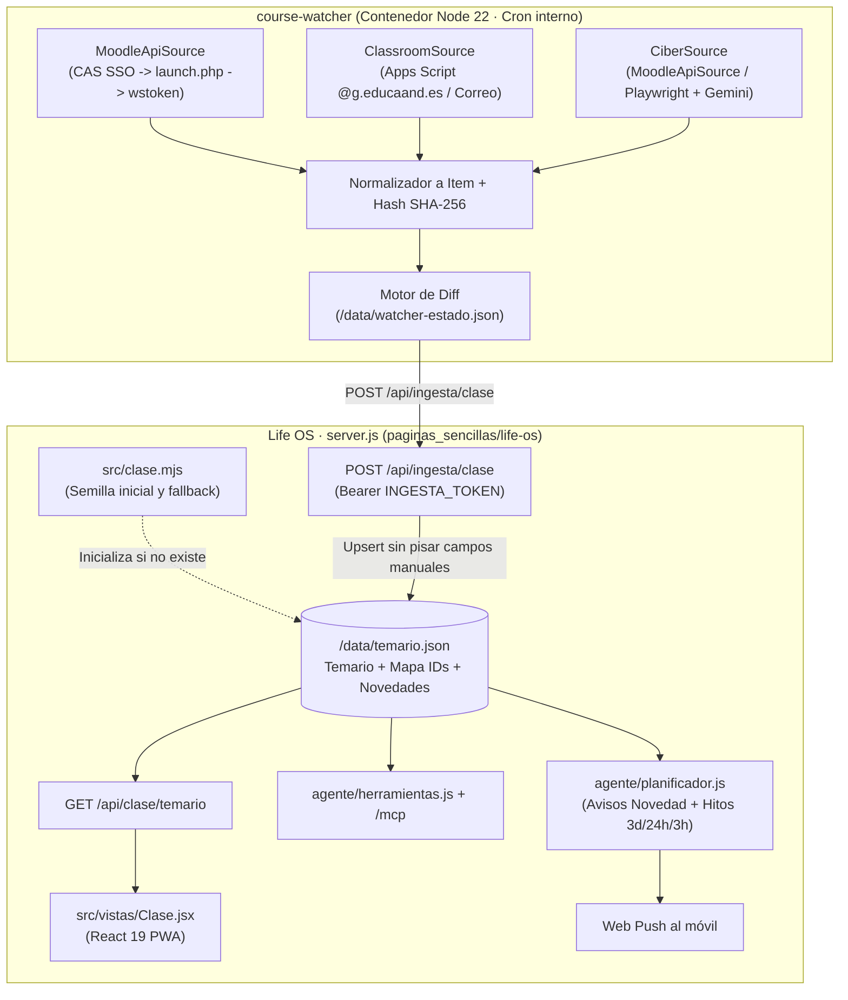

# Arquitectura del Sistema — Course Watcher + Life OS

## 1. Visión General

**Course Watcher** es un servicio autónomo en Node.js $\ge 22$ desplegado en un contenedor independiente en EasyPanel que consulta periódicamente las plataformas de los cursos de Sadek, normaliza el temario, entregas, pruebas, anuncios y calificaciones al modelo común `Item`, detecta novedades respecto al estado anterior y las envía mediante `POST /api/ingesta/clase` a **Life OS**.

---

## 2. Decisiones Arquitectónicas Clave

1. **Node.js 22 sin frameworks en ambos servicios**:
   - Mismo lenguaje, mismo sistema de pruebas (`node --test`) y compartición directa de la lógica del temario (`clase.mjs`).
2. **Moodle Centros 100% por API REST con intercambio SSO CAS automático**:
   - En la Fase 0 se demostró que Moodle Centros usa `typeoflogin: 3` (SSO CAS en `edea.juntadeandalucia.es`), pero permite obtener el `wstoken` oficial de la app móvil haciendo el login CAS con `fetch` nativo y llamando a `/admin/tool/mobile/launch.php?service=moodle_mobile_app`.
   - Esto evita por completo necesitar Playwright o un navegador headless para Moodle Centros: consume menos de 50 MB de RAM y tarda menos de 2 segundos.
3. **Temario en `/data/temario.json`, progreso en Google Sheets (`Clase`)**:
   - El temario completo no se guarda en Google Sheets para no consumir la cuota diaria de Google Apps Script.
   - Lo marcado como completado (`hecho`) sigue en la pestaña `Clase` de Google Sheets para mantener la sincronización multi-dispositivo actual.
4. **Protección estricta de campos manuales**:
   - `src/clase.mjs` contiene notas de Sadek (`nota`, `alerta`, `ahora`, `color`, `meta`, `corto`). El motor de ingesta actualiza únicamente los datos que vienen de la plataforma (`n`, `tipo`, `fecha`, `url`, `publicado`, `hash`, `nota_calificacion`) sin sobrescribir jamás las anotaciones manuales.

---

## 3. Modelo de Datos (`Item` y `/data/temario.json`)

### 3.1. Contrato `Item` (Enviado por Course Watcher)

| Campo | Tipo | Ejemplo | Descripción |
| :--- | :--- | :--- | :--- |
| `ext_id` | `string` | `"moodle:2005:cm:354210"` | Identificador externo único y estable en la plataforma origen |
| `origen` | `string` | `"moodle"` \| `"classroom"` \| `"scraper"` | Fuente de la que procede el elemento |
| `modulo` | `string` | `"ent"` \| `"est"` \| `"poo"` \| `"ana"` \| `"cib-..."` | Código corto del módulo en Life OS |
| `unidad` | `string` | `"UD3"` \| `"T1"` \| `"U2"` | Código de la unidad o bloque temático |
| `unidad_titulo` | `string` | `"Sentencias iterativas"` | Título de la unidad si es nueva |
| `n` | `string` | `"Proyecto U3: mapa web de volcanes con Folium"` | Nombre visible del item |
| `tipo` | `string` | `"Tema"` \| `"PDF"` \| `"Notebook"` \| `"Vídeo"` \| `"Enlace"` \| `"Datos"` \| `"ZIP"` \| `"Entrega"` \| `"Prueba"` \| `"Anuncio"` \| `"Nota"` | Clasificación del elemento |
| `fecha` | `string` | `"2026-11-16T23:59"` | Fecha límite o del examen en hora local `Europe/Madrid` (`yyyy-MM-ddTHH:mm`), o `""` |
| `url` | `string` | `"https://educacionadistancia.../mod/assign/view.php?id=362993"` | Enlace directo a la actividad o recurso |
| `publicado` | `string` | `"2026-11-10T18:30"` | Fecha de publicación o última modificación en plataforma |
| `calificacion` | `object \| null` | `{ "nota": 9.5, "max": 10, "comentario": "Muy bien" }` | Calificación si ha sido publicada |
| `hash` | `string` | `"a1b2c3d4e5f60123"` | Resumen SHA-256 (16 hex) de los campos de plataforma |

### 3.2. Reglas de Migración de IDs Antiguos (`mapaIds`)

1. Al inicializar `/data/temario.json` desde `src/clase.mjs`, cada item conserva su identificador tradicional `id_antiguo = "${m.id}/${u.k}/${it.n}"`.
2. En la primera ingesta desde el watcher, el emparejador asocia cada item de `clase.mjs` con su `ext_id` correspondiente (por coincidencia exacta o normalizada de nombre dentro del módulo/unidad) y guarda la entrada en `mapaIds[id_antiguo] = ext_id`.
3. `hechoItem(ctx, m, u, it)` considera completado un item si cualquiera de sus identificadores (`it.ext_id`, `it.id_antiguo` o `${m.id}/${u.k}/${it.n}`) figura en `ctx.hecho`, o si su tarea asociada en `ctx.tareas` (enlazada por `ext_id` o por título) está completada.
4. De este modo, aunque el profesor cambie el título de un recurso o tarea en Moodle/Classroom, el progreso marcado en la hoja `Clase` jamás se pierde.

---

## 4. Reglas de Detección de Cambios y Avisos Web Push

| Evento detectado en Ingesta | Tipo de Novedad | Aviso Web Push (`planificador.js`) |
| :--- | :--- | :--- |
| Nueva `Entrega` o `Prueba` | `nueva_actividad` | Inmediato (fuera de silencio): `📌 Nueva entrega: <nombre> (<módulo>, <fecha>)` + entra automáticamente en los hitos de 3d / 24h / 3h |
| Cambio en `fecha` de `Entrega` o `Prueba` | `cambio_fecha` | Inmediato (fuera de silencio): `⚠️ Cambio de fecha: <nombre> pasa al <nueva_fecha>` |
| Nuevo material (`PDF`, `Notebook`, `Vídeo`, `Tema`, `Datos`, `Enlace`) | `nuevo_material` | Agrupado por módulo y pasada: `📚 <N> novedades en <módulo>: <nombres...>` |
| Nuevo `Anuncio` del profesor | `anuncio` | `📣 Anuncio en <módulo>: <título>` |
| Nueva `Nota` publicada (`calificacion.nota !== null`) | `nota_publicada` | `🎓 Nota en <módulo>: <nombre> — <nota>/<max>` |
| 2 fallos consecutivos de una fuente | `alerta_fuente` | `🚨 Fallo en fuente <origen>: revisa las credenciales o el estado del servidor` |

Todos los avisos de novedad respetan el horario de silencio (`23:00` a `07:30` en `Europe/Madrid`) y registran su clave única en `estado.enviados` para no repetirse nunca tras un reinicio.
